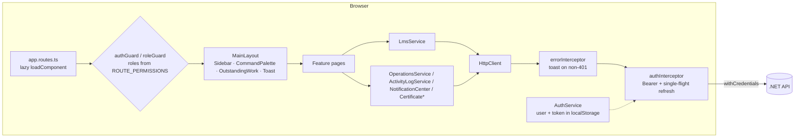

# Frontend audit

Audit of the Angular frontend, taken on 2026-11-24 at commit `fae4016` before any of the
roadmap work began. Findings are referenced by ID from
[frontend-roadmap.md](frontend-roadmap.md) and
[frontend-implementation-log.md](frontend-implementation-log.md).

Paths are relative to `src/app/` unless they start with `src/` or name a root file.

## How it was verified

| Check                                     | Result                                                                                                                                                                                                      |
| ----------------------------------------- | ----------------------------------------------------------------------------------------------------------------------------------------------------------------------------------------------------------- |
| Production build (`CI=true npx ng build`) | Passes. Initial bundle **598.33 kB raw / 133.72 kB transferred** against a 600 kB warning budget. One warning: `RouterLink` unused in `GroupDetailComponent`. Output is `browser/` only — SSR is not built. |
| Unit tests (`ng test --watch=false`)      | 7 files, 78 tests pass. They must be run from `I:\lms`; from the lowercase `i:\lms` path every file fails with "Vitest failed to find the runner".                                                          |
| `npm audit --omit=dev`                    | 16 advisories (1 critical, 9 high). The critical one (`proxy-addr`) arrives through `express`, which only the unbuilt SSR server uses. Most others are build-time tooling. 52 including dev dependencies.   |
| Runtime walkthrough per role              | Not done: needs test accounts on a non-production API.                                                                                                                                                      |

## 1. Summary

A working, feature-rich internal tool with careful domain logic. About a dozen bugs write
wrong data or tell people something untrue; those come before anything cosmetic.

| Area           | Assessment                                                                                                                                                                                                                                                                                                       |
| -------------- | ---------------------------------------------------------------------------------------------------------------------------------------------------------------------------------------------------------------------------------------------------------------------------------------------------------------- |
| Architecture   | Angular 21.2, standalone components, signals, `inject()`, lazy routes, functional interceptors, strict TypeScript. Weighed down by one ~900-line `LmsService`, very large screens (group detail is 1,380 TS + 2,513 HTML lines) and almost no request cancellation (2 `switchMap` across 189 `subscribe` calls). |
| Business logic | Rich and well-explained in comments, with several data-corrupting bugs (§4).                                                                                                                                                                                                                                     |
| Roles          | Role-name based, one route table, but the command palette keeps its own list, components check roles ad hoc, and `roleGuard` lets anyone through a route with no roles. There is no Operations role.                                                                                                             |
| UI/UX          | Coherent, good wording. 51 dialogs, no shared confirmation pattern, load failures often shown as empty data.                                                                                                                                                                                                     |
| Design system  | Colour tokens in `src/styles.css`, but not wired into Tailwind: 2,172 `[var(--color-…)]` classes and hundreds of raw palette classes that ignore dark mode. No spacing or type tokens.                                                                                                                           |
| Security       | No `innerHTML`, no sanitizer bypasses. Default student password, API address editable in production, token in `localStorage`, incomplete sign-out, students can see a class list.                                                                                                                                |
| Performance    | No `OnPush`. Whole-timetable fetches for one group; eager loads at startup. jsPDF is correctly lazy.                                                                                                                                                                                                             |
| Responsive     | Mobile drawer and some card fallbacks; group detail, filter bars and a few grids break on phones.                                                                                                                                                                                                                |
| Accessibility  | 37 `aria-label`s across 46 components, clickable `div`s, modals without focus handling, no page titles, colour-only statuses.                                                                                                                                                                                    |
| PWA            | Nothing yet: no manifest, service worker or icons.                                                                                                                                                                                                                                                               |
| Testing        | Utilities and the auth interceptor only. No component, guard or end-to-end tests; no linter; no CI.                                                                                                                                                                                                              |
| Production     | No environment configuration (API address hard-coded twice), unused SSR scaffolding, no nginx security headers, no error monitoring, out-of-date `AGENTS.md`.                                                                                                                                                    |

## 2. Architecture

- Stack: Angular 21.2, TypeScript 5.9 (`strict`, `strictTemplates`), npm 11, `@angular/build:application` (esbuild), Tailwind 4.3 + per-component SCSS, PrimeNG 21 (Aura) used for dialog, button, select, spinner, toast, tag, paginator and input; all 16 tables are hand-built. PrimeIcons. jsPDF loaded on demand. Vitest 4 + jsdom.
- State: signals in components and a few root services (`AuthService`, `NotificationCenterService`, `OperationsService`, `ThemeService`, `ClockFormatService`). No store.
- Deployment: static files through nginx in Docker on DigitalOcean (`.do/app.yaml`); a `vercel.json` also exists.

Roles in code (`core/interfaces/Role.ts`): Student 1, Instructor 2, Admin 3, Sales 4.
"Operations" is Admin: `OPERATIONS_ROLES = [Admin, Instructor]`, and the rota assigns
admins to weekdays.

## 3. Feature inventory

| Feature                                    | Admin  | Instructor | Sales | Student | State                                                             |
| ------------------------------------------ | :----: | :--------: | :---: | :-----: | ----------------------------------------------------------------- |
| Dashboard (per-role view)                  |   ✓    |     ✓      |   ✓   |    ✓    | Complete; the instructor branch's requests are paid by every role |
| Schedule (7 views + session panel)         |   ✓    |     ✓      |   –   |    ✓    | Analytics is a placeholder; matrix views lose their date          |
| Session detail `/sessions/:id`             |   ✓    |     ✓      |   –   |    ✓    | Complete, with C-01, C-04, C-12                                   |
| Attendance ("Sessions")                    |   ✓    |     ✓      |   –   |    –    | Lists sessions; cannot take attendance itself                     |
| Groups + group detail                      |   ✓    |     ✓      |   –   |    –    | Three dialogs unreachable, two placeholder columns, garbled text  |
| Students + detail                          |   ✓    |     –      |   –   |    –    | Complete                                                          |
| Instructors + detail + register compliance |   ✓    |     –      |   –   |    –    | Complete; detail page only hard-deletes                           |
| Courses                                    | ✓ edit |     ✓      |   ✓   |    ✓    | Complete                                                          |
| Monthly reports                            |   ✓    |     ✓      |   –   |    –    | Complete apart from C-10                                          |
| History & events                           |   ✓    |     ✓      |   –   |    –    | Partial, older style                                              |
| Sales                                      |   ✓    |     –      |   ✓   |    –    | Complete but rough (C-07, C-09)                                   |
| Availability                               |   ✓    |     ✓      |   ✓   |    –    | Complete                                                          |
| Session summaries                          |   ✓    |     ✓      |   ✓   |    –    | Complete                                                          |
| My Learning                                |  ✓\*   |     –      |   –   |    ✓    | First group only; \*Admin sees an empty page                      |
| Operations rota                            |   ✓    |     –      |   –   |    –    | Complete                                                          |
| Activity analytics                         |   ✓    |     –      |   –   |    –    | Complete, server-side paging                                      |
| Profile                                    |   ✓    |     ✓      |   ✓   |    ✓    | Placeholder: nothing reaches the server                           |
| Settings                                   |  URL   |    URL     |  URL  |   URL   | Development tool reachable in production                          |

Unused: `features/home/*`, `shared/layouts/auth-layout/*`,
`core/interceptors/user-id.interceptor.ts`, three group-detail dialogs, the schedule's
cancel-and-shift modal, ~300 lines of dashboard CSS.

## 4. Critical findings

| ID   | Severity    | Finding                                                                                                                                                             | Evidence                                                                                                                  |
| ---- | ----------- | ------------------------------------------------------------------------------------------------------------------------------------------------------------------- | ------------------------------------------------------------------------------------------------------------------------- |
| C-01 | Critical    | Unmarked students saved as Present                                                                                                                                  | `features/sessions/session-detail/session-detail.component.ts:49-61, 427-432`                                             |
| C-02 | Critical    | Students created without a password get `pass2word`                                                                                                                 | `features/students/students.component.ts:466-469`                                                                         |
| C-03 | High        | Profile password change and detail saves never reach the server                                                                                                     | `features/profile/profile.component.ts:101-133`                                                                           |
| C-04 | High        | A failed session edit is applied on screen and called "updated locally"                                                                                             | `features/schedule/session-detail-panel/session-detail-panel.component.ts:281-296`, `session-detail.component.ts:722-737` |
| C-05 | High        | Schedule analytics shows hard-coded figures, to students too                                                                                                        | `features/schedule/components/schedule-analytics/schedule-analytics.component.ts:163, 251, 342-387`                       |
| C-06 | High        | Outstanding-work window sends instructors to registers locked after 24 h; sign-out is under it                                                                      | `shared/components/outstanding-work/*`, `session-detail.component.ts:208-224`                                             |
| C-07 | High        | `toISOString().slice(0,10)` on local dates is a day early east of UTC (Sales trial dates and ~10 other places)                                                      | `features/sales/sales.component.ts:87, 399-423`                                                                           |
| C-08 | High        | Group detail fills location "MOA", removes courses without the warning dialog, refuses to save a group with no end date                                             | `group-detail.component.ts:603, 625, 632, 688, 700`; `.html:935`                                                          |
| C-09 | High        | Cancelling the release prompt still releases; candidates delete unconfirmed; "Cancelled" status bypasses the reason dialog; schedule actions visible to instructors | `sales.component.ts:375`; panel and session-detail status selects; `groups.component.html:280-406`                        |
| C-10 | High        | Releasing a report discards unsaved edits; nothing warns before leaving                                                                                             | `evaluation-detail.component.ts:381-394`                                                                                  |
| C-11 | High        | API address changeable from `/settings` by any role in production; credentials follow it                                                                            | `core/services/lms.service.ts:104-125`, `core/interceptors/auth.interceptor.ts:165-168`                                   |
| C-12 | Medium-High | Students see the class list and Save on `/sessions/:id`; `lms_attendance_*` cache never cleared and resurrects departed students                                    | `session-detail.component.html:318-620`, `.ts:338-355, 490`                                                               |
| C-13 | Medium      | Token in `localStorage`; session expiry leaves bell and outstanding-work state; no cross-tab sign-out                                                               | `core/services/auth.service.ts:96`, `auth.interceptor.ts:150-162`                                                         |
| C-14 | Medium      | No request cancellation: fast filter changes can show stale data                                                                                                    | schedule, evaluations, register compliance, history, availability                                                         |
| C-15 | Medium      | No Operations role; Admin acts as operations                                                                                                                        | `core/interfaces/Role.ts`                                                                                                 |

## 5. Detailed findings

**Architecture and code quality.** `LmsService` builds query strings by hand without
encoding and returns `any` in places. Large components: group detail (~80 signals,
16 dialogs), sales (618 + 924 + 872 lines), session detail (796 TS + 1,334 SCSS); the
schedule panel and session page duplicate edit/cancel/delete logic. 46 `any`. Mixed
`*ngIf` and `@if`. Mis-encoded text in `lms.service.ts` comments, group detail and
`courses.component.html:480`. About 20 components toast errors the interceptor already
toasts. No linter.

**Business logic.** Duplicate submits (extend hold adds 14 days per click; one shared
"releasing" flag in the reports list; no in-flight guard on trial outcome, candidate
status, withdraw). Bulk student actions stop at the first failure and never reload.
Bulk attendance falls back to one request per student on any error. Three week
definitions (Saturday, Monday, Sunday start). Instructors matched by name substring.
Whole-timetable fetches to show one group.

**Admin / Operations.** C-08; hard-coded "Enrolled"/"Active" columns; links instructors
cannot open; `[object Object]` in the course-sessions dialog; blank page on load failure.

**Sales.** Slot search → hold → candidate → trial → Admin converts. C-07, C-09, `prompt()`
for reasons, empty-looking pipeline on error, all holds and candidates loaded without
`mineOnly` (server scoping unverified).

**Instructor.** C-06; availability matrix shows the first instructor, not the signed-in
one; attendance page cannot take attendance.

**Student.** First group only in My Learning; staff tabs on the schedule; C-12.

**Roles.** `roleGuard` fails open on an empty role list; the command palette sends Sales and
Students to refused pages; scattered `isAdmin` checks. The server must enforce every
rule independently.

**Design system.** Tokens not exposed to Tailwind; ~99 literal colours; hundreds of palette
classes; `dark:` follows the OS, not `data-theme` (inferred); `--color-role-badge-bg`
defined twice; Inter named but never loaded; emojis as icons; one global `::ng-deep`
leak (`features/activity-logs/activity-logs.component.scss:4`).

**Responsive.** 300 px minimum grids overflow at 320 px; group detail header and tables;
stacked filter bars; hover-only controls; `100vh` in the blocking window; sidebar flash on
phones.

**Performance.** No `OnPush`; matrix cells loop over every session from the template; the
command palette loads all students, groups and topics at startup; the schedule's add
dialog loads students and instructors eagerly; the dashboard fires 4 requests for every
role; the Settings health check downloads the whole schedule.

**Accessibility.** One page title for every route; clickable rows and `div`s; three modals
without focus handling; labels not linked to inputs; icon buttons named only by `title`;
colour-only statuses; login error not announced.

**Production.** No environment files, two deployment targets, no nginx security headers
or cache rules, no CI or error monitoring; `@primeng/themes` deprecated in favour of
`@primeuix/themes`; `@angular/animations` and `ngx-toastr` unused.

## 6. Security

| ID   | Severity | Finding                                                          | Frontend                                     | Backend                                                                |
| ---- | -------- | ---------------------------------------------------------------- | -------------------------------------------- | ---------------------------------------------------------------------- |
| S-1  | Critical | Default `pass2word` (C-02)                                       | Require a password                           | Invite flow; reject empty or weak passwords                            |
| S-2  | High     | API address editable in production (C-11)                        | Build-time config; development-only override | –                                                                      |
| S-3  | High     | Fake password change (C-03)                                      | Hide it                                      | Change-password endpoint                                               |
| S-4  | Medium   | Token in `localStorage`, no cross-tab sign-out (C-13)            | Token in memory, tab sync                    | Confirm refresh cookie is `HttpOnly; Secure; SameSite`, CSRF-protected |
| S-5  | Medium   | Incomplete sign-out                                              | One sign-out routine                         | –                                                                      |
| S-6  | Medium   | Students see class list and Save (C-12)                          | Hide by role                                 | Verify the server refuses and filters                                  |
| S-7  | Medium   | Sales sees all candidates' phones and instructors' leave reasons | `mineOnly` for Sales                         | Server-side scoping                                                    |
| S-8  | Medium   | No CSP, `frame-ancestors`, HSTS, `nosniff`, Referrer-Policy      | –                                            | Infrastructure                                                         |
| S-9  | Low      | `roleGuard` fails open                                           | Deny by default                              | –                                                                      |
| S-10 | Low      | Unencoded query strings                                          | `HttpParams`                                 | –                                                                      |
| S-11 | Low      | 16 production advisories, mostly via unused `express`            | Remove SSR if unused; `npm audit fix`        | –                                                                      |

## 7. PWA strategy (summary)

Foundations first (build-time API config, one sign-out routine, nginx cache headers), then
`@angular/service-worker` caching **the app shell and static assets only** — no API
responses, because the data is about children and devices are shared. Then an update
prompt, offline banner and page, install experience. A read-only offline week for
instructors is optional and needs a security sign-off.
